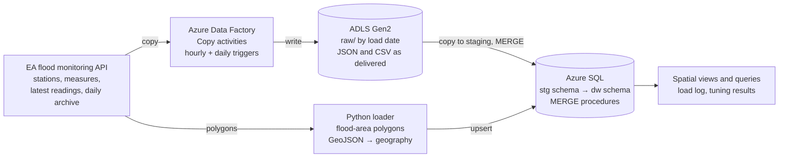
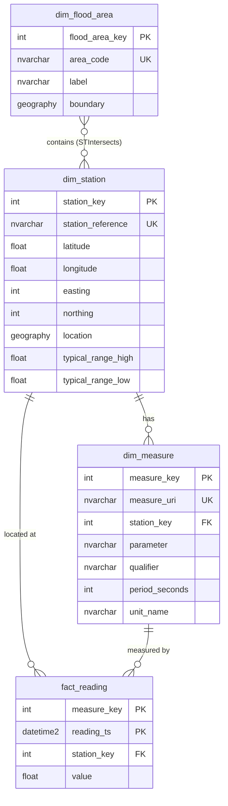
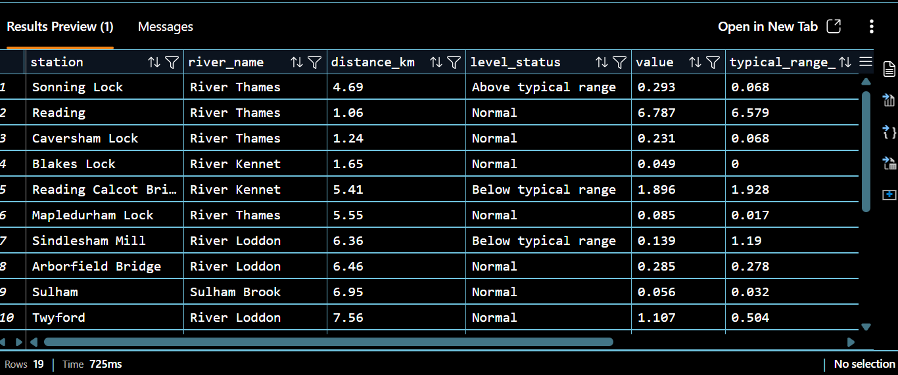

# Azure Flood Monitoring Pipeline

A personal project: a scheduled Azure data pipeline that ingests live river-level data from the Environment Agency, lands it in a data lake, models it in Azure SQL as a star schema with spatial types, and answers location questions such as *"which monitoring stations within 10 km of Reading are running above their typical range?"*

Built over a weekend to get hands-on with Azure Data Factory, ADLS Gen2 and Azure SQL (SQL Server), coming from a Databricks background.

**Stack:** Azure Data Factory · ADLS Gen2 · Azure SQL Database (serverless, free offer) · T-SQL · Python (uv, requests, shapely, pyodbc) · GitHub

---

## Contents

- [Architecture](#architecture)
- [Repository layout](#repository-layout)
- [Pipelines](#pipelines)
- [Data model](#data-model)
- [Spatial queries](#spatial-queries)
- [Performance tuning](#performance-tuning)
- [Design decisions](#design-decisions)
- [Problems hit and how they were fixed](#problems-hit-and-how-they-were-fixed)
- [How to deploy](#how-to-deploy)
- [Cost](#cost)
- [What I'd do next](#what-id-do-next)
- [Data source and attribution](#data-source-and-attribution)

---

## Architecture



Data Factory does the scheduled work: it copies API responses into a raw zone in the lake exactly as delivered, then a separate pipeline loads them into staging tables in Azure SQL and stored procedures MERGE staging into a dimensional model. A small Python script handles the one job ADF isn't suited to, cleaning and orienting flood-area polygons before loading them as SQL Server `geography`. All ADF assets are versioned in this repo through ADF's GitHub integration.

Storage and Data Factory run in UK South. The SQL server runs in Europe because the subscription was not allowed to create SQL servers in UK South (see [Problems hit](#problems-hit-and-how-they-were-fixed)).

---

## Repository layout

```
Data Factory pipelines, datasets, linked services, triggers (ADF Git integration)
/sql        Database scripts, run in order
  01_schemas.sql    stg and dw schemas
  02_staging.sql    loose-typed staging tables
  03_dims.sql       dim_station, dim_measure, dim_flood_area
  04_fact.sql       fact_reading
  05_procs.sql      load_log, MERGE procedures, failure logging
  06_spatial.sql    spatial function and views
  07_tuning.sql     test queries and indexes
/python     Flood-area polygon loader (uv project)
  load_flood_areas.py
  .env.example
```

---

## Pipelines

| Pipeline | Trigger | What it does |
| --- | --- | --- |
| `pl_ingest_stations` | Daily | Copies `id/stations?_view=full` and `id/measures` into `raw/stations/` and `raw/measures/`, one snapshot per day |
| `pl_ingest_readings` | Hourly (`tr_hourly`) | Copies `data/readings?latest` into `raw/readings/load_date=yyyy-MM-dd/readings_HHmm.json` |
| `pl_backfill_archive` | Manual | ForEach over the last N days (`range()` + `addDays()`), copying each daily archive CSV into `raw/readings_archive/` |
| `pl_load_sql` | Manual | Copies lake files into `stg` tables, runs the MERGE procedures, logs counts, fails loudly on error |

Points worth noting:

- **Binary datasets for ingestion.** The raw zone is a byte-for-byte copy, so one source and one sink dataset handle both JSON and CSV.
- **`pipeline().TriggerTime`, not `utcnow()`,** for date folders, so every activity in a run uses the same timestamp and a run crossing midnight can't split across two folders.
- **No Set Variable inside the parallel ForEach** in the backfill. Pipeline variables are shared across parallel iterations, so the date expression is repeated instead.
- **Failure path in `pl_load_sql`:** on failure, a stored procedure logs the error to `dw.load_log`, then a Fail activity re-raises it. Without the Fail activity, a successful error handler makes the whole run report Succeeded.
- **Retries** (2 × 60 s) on every Copy activity, because the source API has no uptime guarantee.

---

## Data model



- **`stg` schema:** loose types (mostly `nvarchar`), no keys, truncated and reloaded each run, so a malformed row never fails a copy.
- **`dw` schema:** strict types, surrogate keys with `UNIQUE` constraints on natural keys, written only by MERGE procedures.
- **Grain of the fact:** one value per measure per timestamp, enforced by the clustered primary key (`measure_key`, `reading_ts`).
- **Dimensions are SCD type 1** (overwrite). Type 2 would be the next step if station details needed an audit trail.
- **`dw.load_log`** records inserted, updated and rejected counts for every step of every run, from both ADF and Python.

---

## Spatial queries

Defined in `sql/06_spatial.sql`:

- `dw.fn_stations_near(@lat, @long, @radius_km)`: inline table-valued function using `STDistance` (metres)
- `dw.v_station_flood_area`: spatial join of stations to flood-area polygons using `STIntersects`
- `dw.v_station_latest_level`: latest stage reading per station against its typical range, labelled Above / Normal / Below

The headline question: Which stations within 10km of READING are running above typical range? 

```sql
SELECT n.label AS station, n.river_name, n.distance_km,
       l.value, l.typical_range_high, l.level_status, l.reading_ts
FROM dw.fn_stations_near(51.4543, -0.9781, 10) AS n
JOIN dw.v_station_latest_level AS l
  ON l.station_key = n.station_key
ORDER BY CASE l.level_status WHEN 'Above typical range' THEN 0 ELSE 1 END,
         n.distance_km;
```



> 19 stations within 10 km, 1 above typical range on 15 Nov 2026.

---

## Performance tuning

Method: `SET STATISTICS IO, TIME ON`, each query run twice with the second (warm-cache) run recorded, actual execution plan captured, one index added at a time. **Logical reads** are the main metric because elapsed time on a small serverless database varies with caching and load.

| Query | Index added | Logical reads before | Logical reads after | Change | Plan before → after |
| --- | --- | --- | --- | --- | --- |
| Q1 stations within 10 km | `SIX_dim_station_location` (spatial) | 276 | 59 | 78.62% | clustered  index scan -> clustered index seek |
| Q2 stations inside flood areas | `SIX_dim_flood_area_boundary` (spatial) | 16560 | 339 | 97.95% | clustered  index scan -> clustered index seek |
| Q3 latest level per measure | none (clustered key already fits) | 135 | n/a | n/a | Clustered Index Seek |
| Q4 max reading per station, last 24 h | `IX_fact_reading_reading_ts` INCLUDE (station_key, value) | 22525 | 233 | 98.96% | clustered index scan -> index scan |

- **Q3 needed no index:** the clustered key (`measure_key`, `reading_ts`) matches "newest reading per measure" exactly. The cheapest tuning was choosing the key from the access pattern.
- **Q4 is the headline result:** filtering on `reading_ts`, the second key column, forced a full scan of the fact table. A covering index led by `reading_ts` turns it into a range seek.
- **Trade-off:** the indexes slow writes. `pl_load_sql` MERGE duration did not increase noticable after index creation, but with 2 more days of data, this would start to show up.


---

## Design decisions

**Why a raw zone in the lake before SQL?**
The API is a moving target: readings arrive in batches and fields change shape. Keeping every response exactly as delivered means any load can be replayed or rebuilt from source, without calling the API again.

**Why MERGE rather than INSERT?**
`data/readings?latest` returns the latest value per measure, and many stations only report once or twice a day, so consecutive hourly files repeat the same readings. The daily archive then contains them again. MERGE on (`measure_key`, `reading_ts`) makes the load idempotent: re-running a load, or loading overlapping sources, never creates duplicates. This was verified by running `pl_load_sql` twice and confirming the second run inserted close to nothing.

**Why truncate staging every run?**
History lives in `dw.fact_reading`, which is never truncated. Staging only holds the current batch, which keeps the MERGE working on a known set and makes re-runs safe.

**Why `geography` over `geometry`?**
`geography` calculates distances and areas on the Earth's curved surface in real units (metres) from lat/long (SRID 4326), which is what "within 10 km" needs. `geometry` is flat and suits projected coordinates such as British National Grid eastings and northings. The station table keeps both coordinate types, so either could be used.

**Why Python for polygons?**
ADF copies data well but can't repair or reorient geometry. The script repairs shapes with shapely, orients outer rings anticlockwise as SQL Server's geography type requires, and rejects (and counts) anything still unusable. SQL Server's `MakeValid()` and `ReorientObject()` are a second safety net.

**Why managed identity?**
Data Factory reaches both the lake and the database through its own system-assigned managed identity with role-based access, so there are no keys or connection strings in the pipelines. The SQL login is used only by the local Python script, and its credentials live in an untracked `.env` file.

---

## Problems hit and how they were fixed

Real issues from the build, kept because the fixes were the most useful learning.

| Problem | Cause | Fix |
| --- | --- | --- |
| Couldn't create the SQL server in UK South: "Your subscription does not have access to create a server in the selected region" | Region restriction on a new subscription | Deployed the SQL server to UK West; the rest stays in UK South. Cross-region transfer at this volume is negligible |
| ADF Debug failed with `BadRequest` and a null message | A stray space in a dataset parameter value | Removed the space. Lesson: Validate first, and treat parameter values as exact strings |
| Copy failed: `OutOfRangeInput`, FileSystem `id` | A test value left as a dataset parameter default pushed part of the API path into the container name (container names need 3+ characters) | Cleared dataset parameter defaults so the pipeline always supplies values |
| Copy failed: `AdlsGen2InvalidFolderPath`, writing a file with a GUID name | Editing the dataset parameters wiped the sink values on the Copy activity, so container and file name arrived empty | Re-entered the sink values. ADF falls back to a GUID file name when none is given |
| VS Code SQL extension: "client is not running" | The extension's background service failed to start | Opened vscode in plain Windows window instead of WSL |
| Import schemas: "please select a table", and a prompt for "additional expressions" | The SQL dataset's table had to use the Edit option with `@dataset()` expressions; pipeline variables have no value at design time | Switched the dataset to editable schema and table expressions, and gave the variable a real date in the import dialog |
| Copy failed: "One or more 'source' in copy activity mapping doesn't point to any data" | Import schemas added mapping rows with no source (such as `loaded_at_utc`, which the database fills) | Deleted the empty mapping rows |
| Copy failed: `JsonUnsupportedHierarchicalComplexValue` on `catchment_name` | Some stations return a list instead of a single value for fields like catchment, label or lat/long | Enabled "Map complex values to string", widened the staging columns, and added `dw.fn_first_value` to take the first element in the MERGE. No rows dropped |
| Python: `Login timeout expired` connecting from WSL | The free database resuming from auto-pause took too long | re-run; connection retry with 30 s backoff added to the script allowed python to connect from WSL |

---

## How to deploy

**Prerequisites:** an Azure subscription, a GitHub account, VS Code with the SQL Server (mssql) extension, and WSL or Linux with Python, [uv](https://docs.astral.sh/uv/) and Microsoft ODBC Driver 18 for SQL Server.

1. **Resource group** `rg-flood-pipeline` (UK South), tagged `project = flood-pipeline`. Set a budget alert first.
2. **Storage account** with hierarchical namespace enabled (ADLS Gen2), containers `raw` and `curated`.
3. **Data Factory**, connected to this repo (collaboration branch `main`, publish branch `adf_publish`, root folder `/adf`). Grant its managed identity **Storage Blob Data Contributor** on the storage account.
4. **Azure SQL** server and database (free offer, auto-pause when the free limit is reached), with Microsoft Entra and SQL authentication enabled and your client IP allowed through the firewall.
5. **Database objects:** run `sql/01` to `sql/06` in order, connected to the database (not `master`).
6. **Database access for Data Factory** (run as the Entra admin):
   ```sql
   CREATE USER [adf-flood-jc] FROM EXTERNAL PROVIDER;
   ALTER ROLE db_datareader ADD MEMBER [adf-flood-jc];
   ALTER ROLE db_datawriter ADD MEMBER [adf-flood-jc];
   ALTER ROLE db_ddladmin  ADD MEMBER [adf-flood-jc];
   GRANT EXECUTE TO [adf-flood-jc];
   ```
7. **Run the pipelines:** publish, start the triggers, run `pl_backfill_archive` once, then `pl_load_sql`.
8. **Load polygons:** in `/python`, copy `.env.example` to `.env`, fill it in, then `uv sync` and `uv run load_flood_areas.py`.
9. **Tune:** run `sql/07_tuning.sql` section by section, following the method above.

To tear everything down, stop the triggers and delete the resource group.

---

## Cost

> £0.63 total from Cost Management → Cost analysis, filtered by tag `project = flood-pipeline`, for 14–16 Nov 2026.

Kept low by design: the Azure SQL free offer (100,000 vCore seconds and 32 GB per month, auto-pausing at the limit), Copy activities and stored procedures only (no Mapping Data Flows or dedicated Synapse pools), a manual `pl_load_sql`, and the hourly trigger stopped after the weekend.

---

## What I'd do next

1. **Power BI dashboard** connected to Azure SQL: a map of stations coloured by latest level against typical range, flood-area polygons as an overlay, and a time series per station from `fact_reading`.
2. **Infrastructure as code:** define the storage account, Data Factory (with Git settings), SQL server and database, role assignments and firewall rules in Bicep, so the whole environment deploys from this repo in one command, with ADF changes promoted through CI/CD.

Further improvements identified during the build:

- **Incremental loading:** load only new archive files (filtering by last-modified time against a watermark, or moving processed files to `processed/`) instead of all seven each run.
- **Orchestration:** chain `pl_load_sql` after ingestion with an Execute Pipeline activity rather than running it manually.
- **Python loader:** load in bulk through a staging table, run it on a schedule from an Azure Function, and move secrets to Key Vault.

---

## Data source and attribution

This uses Environment Agency flood and river level data from the real-time data API (Beta).

Data is available under the [Open Government Licence v3.0](https://www.nationalarchives.gov.uk/doc/open-government-licence/version/3/). API reference: <https://environment.data.gov.uk/flood-monitoring/doc/reference>. The API carries no service-level guarantee and this project is not intended for safety-critical use.